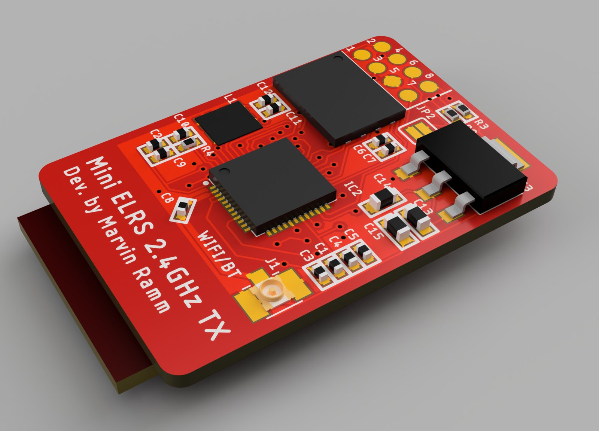
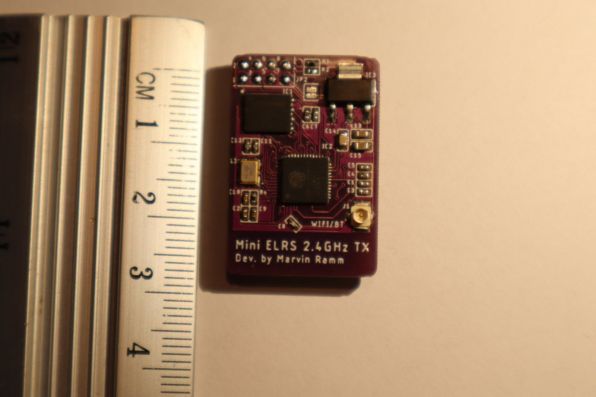
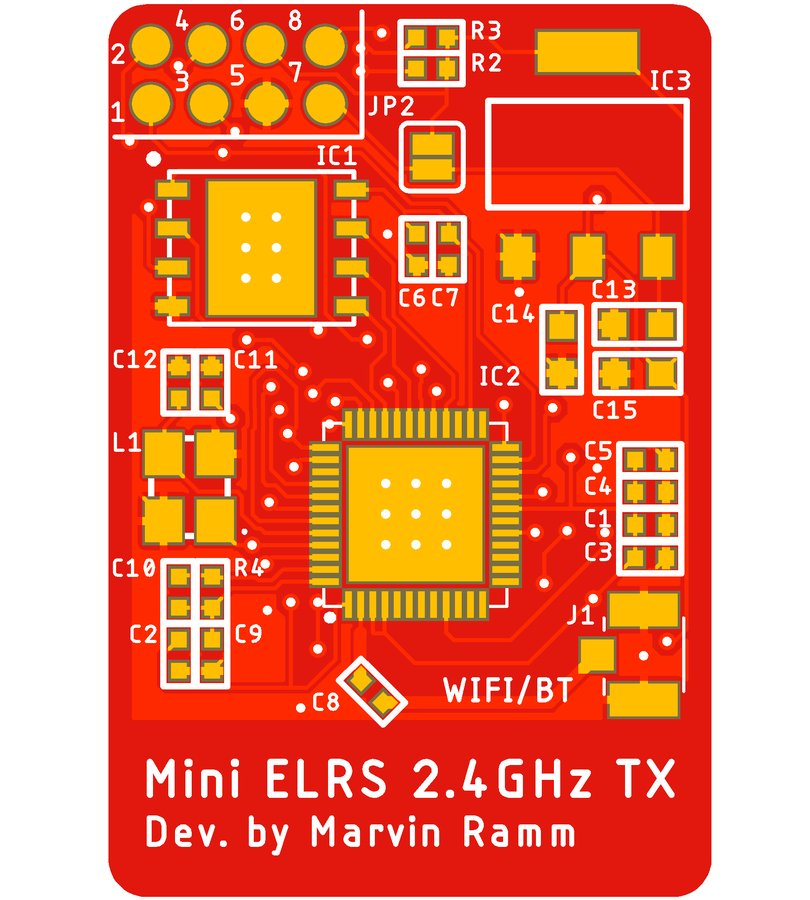
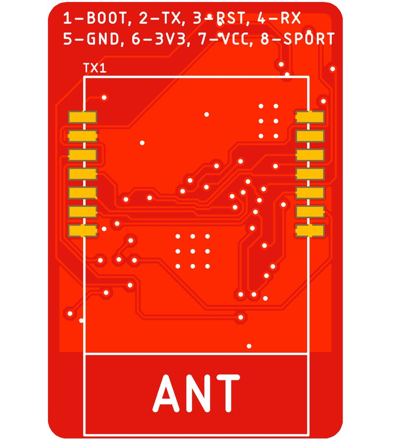
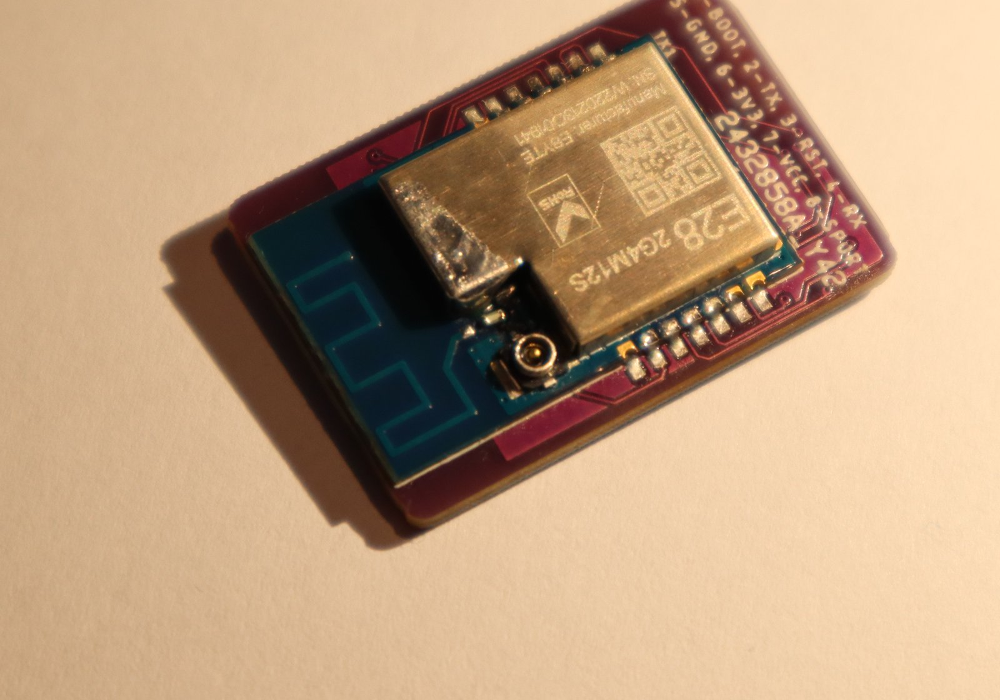

# Mini 2.4 GHz TX for ExpressLRS

[](LICENSE)

**A compact open-hardware transmitter module for the [ExpressLRS](https://github.com/ExpressLRS/ExpressLRS) radio link. It is a 2-layer board of only 19.75 × 29.25 mm with an ESP32, an SX1280 radio module and a U.FL connector for Wi-Fi.**

<p align="center">
  
  
</p>

ExpressLRS is an open-source radio link between RC transmitter and model with low latency and long range. I designed this board in 2022 as my own small alternative to the commercial TX modules. It runs the unmodified ExpressLRS firmware.

## Hardware

| | |
|---|---|
| **MCU** | ESP32-D0WDQ6 with 4 MB SPI flash (W25Q32), 40 MHz crystal |
| **Radio** | Ebyte E28-2G4M12S (Semtech SX1280, 2.4 GHz, 12.5 dBm ≈ 18 mW, no external PA), on the bottom side |
| **Antennas** | PCB antenna of the E28 module for the RC link; U.FL connector for the Wi-Fi/Bluetooth antenna of the ESP32 (updates and configuration over Wi-Fi) |
| **Power** | `VCC` via AMS1117-3.3. Solder jumper `JP2` bypasses the regulator if the module is supplied with 3.3 V directly. |
| **Interface** | Single-wire serial (`SPORT`) to the radio, the standard interface of ExpressLRS TX modules |
| **PCB** | 2 layers, 19.75 × 29.25 mm, 1.2 mm thick, minimum trace width 0.15 mm |

<p align="center">
  
  
  
</p>

### Pads

The eight pads at the top edge carry everything that is needed for flashing and operation. The assignment is also printed on the bottom silkscreen.

| Pad | Signal | Pad | Signal |
|---|---|---|---|
| 1 | `BOOT` (GPIO0) | 2 | `TX` (U0TXD) |
| 3 | `RST` (EN) | 4 | `RX` (U0RXD) |
| 5 | `GND` | 6 | `3V3` |
| 7 | `VCC` (regulator input) | 8 | `SPORT` (GPIO13) |

### ESP32 ↔ SX1280

| Signal | GPIO | Signal | GPIO |
|---|---|---|---|
| `NSS` | 5 | `BUSY` | 21 |
| `SCK` | 18 | `DIO1` | 4 |
| `MOSI` | 23 | `DIO2` | 2 |
| `MISO` | 19 | `NRESET` | 14 |

## Firmware

The firmware is the official **ExpressLRS** firmware ([ExpressLRS/ExpressLRS](https://github.com/ExpressLRS/ExpressLRS), GPL-3.0). It is not part of this repository. Build and flash it with the [ExpressLRS Configurator](https://github.com/ExpressLRS/ExpressLRS-Configurator) for a generic ESP32 2.4 GHz TX with the pin assignment above.

For the first upload, connect a 3.3 V USB-to-UART adapter to `TX`, `RX`, `GND` and `3V3`, and pull `BOOT` to `GND` during reset. After that, updates work over Wi-Fi.

## Build

The Gerber, drill and pick-and-place files are attached to the [release](https://github.com/marvinramm/ExpressLRS/releases). The parts are listed in the [BOM](hardware/mini-tx-rev1/Mini-ELRS-TX-REV1_BOM.csv). Order the PCB with 1.2 mm thickness.

```
hardware/mini-tx-rev1/    Schematic (PDF), BOM, EAGLE schematic and board in source/
docs/images/              Pictures used in this README
```

### Open point

- [ ] Add a separate `BOOT`-to-`GND` pad or button, so the first upload works without wiring a jumper

## License

© 2022 Marvin Ramm. The hardware design files, images and documentation are licensed under [CC BY 4.0](LICENSE): commercial use is allowed if you credit "Mini 2.4 GHz TX by Marvin Ramm" with a link to this repository. Details are in [LICENSING.md](LICENSING.md).

The ExpressLRS firmware is a separate project under GPL-3.0. "ExpressLRS" is a trademark of ExpressLRS LLC. This board is a community design and not an official ExpressLRS product.

> The use of radio transmitters may require a license, and some countries restrict it. You are responsible for complying with your local regulations.
